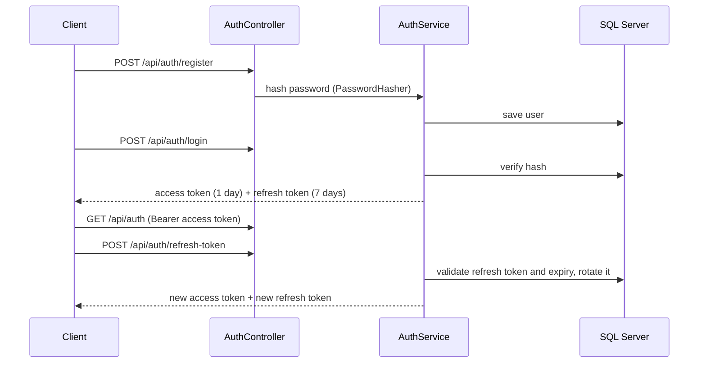

# JWT Authentication on .NET 9

A compact reference implementation of **JWT access tokens + rotating refresh tokens** with
role-based authorization on ASP.NET Core 9.

## Flow



## Endpoints

| Method | Route | Auth | Description |
|---|---|---|---|
| POST | `/api/auth/register` | — | Create a user (password hashed with `PasswordHasher<User>`) |
| POST | `/api/auth/login` | — | Returns access + refresh token |
| POST | `/api/auth/refresh-token` | — | Exchanges a valid refresh token for a new pair (rotation) |
| GET | `/api/auth` | any authenticated user | Protected sample endpoint |
| GET | `/api/auth/admin-only` | role `Admin` | Role-protected sample endpoint |

## Security details

- Access tokens signed with **HMAC-SHA512**; issuer, audience, lifetime and signing key are all validated.
- Refresh tokens are 32 random bytes from `RandomNumberGenerator`, stored per user with an expiry (7 days) and **rotated on every use**.
- Role claim on the token drives `[Authorize(Roles = "Admin")]`.
- Structured logging with **Serilog**, written to the console and to a SQL Server `Logs` table.
- API reference with the built-in OpenAPI document and **Scalar** UI in development.

## Tech

.NET 9 · ASP.NET Core Web API · Entity Framework Core · SQL Server (LocalDB) · JWT Bearer · Serilog · Scalar

## Run

```bash
dotnet user-secrets init --project JwtAuthDotNet9
dotnet user-secrets set "AppSettings:Token" "<your-64+-character-key>" --project JwtAuthDotNet9
dotnet ef database update --project JwtAuthDotNet9
dotnet run --project JwtAuthDotNet9
```

Open `/scalar/v1` in development to try the endpoints, or use `JwtAuthDotNet9.http`.
